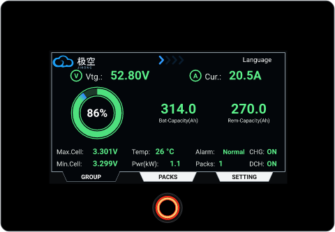
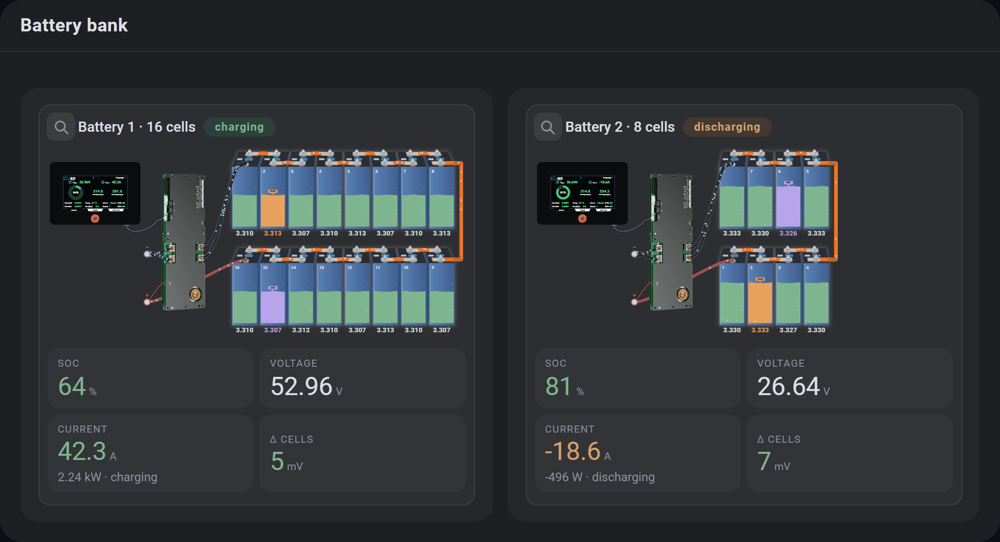
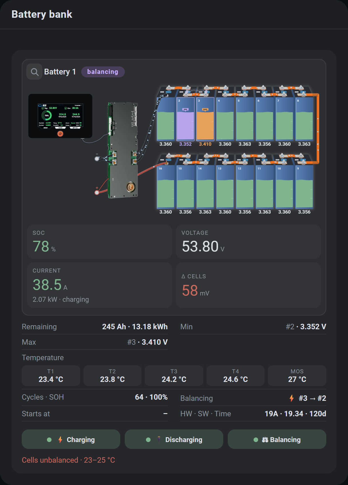
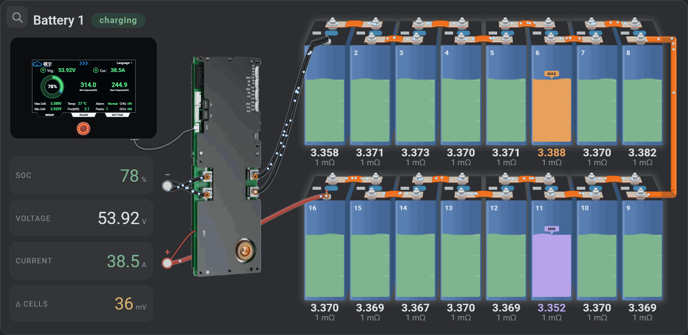

# JK-BMS Battery Card
<p align="center"></p>

A Home Assistant dashboard card for **JK-BMS** battery packs (ESPHome, [syssi/esphome-jk-bms](https://github.com/syssi/esphome-jk-bms)): one calm card per battery with the real pack drawn cell by cell, live current flow, balancing, a replica of the JK touch screen and optional Victron SmartShunt / MultiPlus data. No dependencies.



Each battery has its own number of cells (8 or 16) and temperature sensors; the cells keep their size, the pack just ends earlier. One complete battery card, with the BMS screen replica, the numbers, the facts table and the switches:

<p align="center"></p>

Balancing: the highest cell gives to the lowest one and the two are joined by a lightning, wherever they are in the pack; the electrons run in the real direction of the current.

<p align="center"></p>

> **Tested only with the JK BMS PB2A16S20P v19.** Using the card with another BMS (other model or firmware, different entity names or values) is your own responsibility: expect that things may not work as shown.
>
> **This card is distributed "as is"**, without any warranty of any kind and without any promise of support or fixes. You use it at your own risk.

## Features

- **Pack drawing** (2 rows of cells, 8 or 16 cells per battery): cell voltage and internal resistance, liquid level = SoC, highest cell (MAX) and lowest cell (MIN) marked from the BMS sensors `max_voltage_cell` / `min_voltage_cell`, busbars and cables, electrons moving in the real direction of the current.
- **Balancing**: the cells that exchange charge are joined by a lightning; the status chip shows *balancing* while the balancer works.
- **BMS screen replica**: click it to enlarge. GROUP / PACKS / cells pages like the real display, the round button switches the `display_always_on` switch, the *Language* label changes the language of the whole card.
- **Master / slave groups** (declared in the card, the integration sees every BMS separately): one card, a selector chooses the pack, the screen shows the group totals.
- **Safe switches**: charging / discharging / balancing / heating ask for confirmation.
- **Every value opens its entity** (more-info).
- **Languages**: English, Français, Deutsch, Italiano, Español, Română (files in `translations/`, easy to extend).
- **Light rendering** for phones and tablets (automatic, or forced from the editor).
- Visual editor (battery detection, group roles, language, performance).
- **Victron SmartShunt / MultiPlus data is optional** (a line with the SmartShunt, MultiPlus and history values under the batteries). Leave `victron` out and nothing Victron-related is shown. **Tested only with Venus OS** (entities from a Venus OS / GX device, for example through the Victron MQTT integration); other setups may use different entity names, which you can map one by one in the editor.

## Installation

### HACS (custom repository)

1. HACS → ⋮ → **Custom repositories** → add `https://github.com/valimaties/jk-bms-battery-card`, type **Dashboard**.
2. Install **JK-BMS Battery Card**, then reload the browser (Ctrl+F5).
3. If the resource was not added automatically: *Settings → Dashboards → ⋮ → Resources* → add `/local/community/jk-bms-battery-card/jk-bms-battery-card.js` as **JavaScript module**.

### Manual

The repository always contains the built card in the **`dist/`** folder (`main` and `dev`). Copy `jk-bms-battery-card.js` **and the `translations/` folder** from `dist/` (or from the latest release) to `/config/www/community/jk-bms-battery-card/`, add the resource `/local/community/jk-bms-battery-card/jk-bms-battery-card.js` (JavaScript module) and reload the browser.

> The `translations/` folder must stay next to the `.js` file. Without it the card still works, in English.

## Usage

Add the card from the picker (**JK-BMS Battery**); it detects the batteries (`sensor.*_cell_voltage_1`) and the Victron entities it finds. Or in YAML:

```yaml
type: custom:jk-bms-battery-card
batteries:
  - name: Battery 1
    entity_base: jk_bms_bms0     # sensor.jk_bms_bms0_cell_voltage_1 -> base = jk_bms_bms0
    role: master                 # optional: master | slave
    cells: 16                    # 4, 8 or 16 cells in this battery
    temps: 4                     # temperature sensors of this battery (0-5)
  - name: Battery 2
    entity_base: jk_bms_bms1
    role: slave
    cells: 8
    temps: 2
```

### Options

| Option | Default | Description |
|---|---|---|
| `title` | translated "Battery bank" | Card title |
| `batteries[].name` | entity base | Name shown on the card |
| `batteries[].entity_base` | – | Entity id without `sensor.` and without the `_cell_voltage_1` suffix |
| `batteries[].entities` | – | Override single entities, e.g. `entities: { total_voltage: sensor.my_voltage, display_always_on: switch.my_display }` |
| `batteries[].layout` | `top-left` (1st), `bottom-left` (2nd) | Corner where cell 1 is drawn: `top-left`, `top-right`, `bottom-left`, `bottom-right` |
| `batteries[].cells` | `16` | Cells of this battery: 8 or 16 (the cells keep their size, the row just ends earlier) |
| `batteries[].temps` | `4` | Temperature sensors of this battery (0–4; the MOS temperature is read from its own sensor) |
| `batteries[].role` | – | `master` for one battery, `slave` for the others: one card with a pack selector |
| `glare` | `true` | Light reflection on the BMS screen |
| `language` | `auto` | `auto` (Home Assistant language) or `en` `fr` `de` `it` `es` `ro` |
| `performance` | `auto` | `auto` (light on touch / weak devices), `full`, `lite` |
| `translations_path` | next to the card | URL of a folder containing `translations/` |
| `victron` | – | Optional SmartShunt / MultiPlus entities, see below |

The language chosen on the BMS screen is remembered in that browser and wins over the configuration.

### Entities used

For each battery (`<base>` = `entity_base`): `sensor.<base>_cell_voltage_1..16`, `_cell_resistance_1..16`, `_total_voltage`, `_current`, `_power`, `_state_of_charge`, `_state_of_health`, `_capacity_remaining`, `_charging_cycles`, `_min_cell_voltage`, `_max_cell_voltage`, `_min_voltage_cell`, `_max_voltage_cell`, `_delta_cell_voltage`, `_balancing`, `_temperature_sensor_1..4`, `_power_tube_temperature`, `_errors`, `_hardware_version`, `_software_version`, `_total_runtime_formatted`; `switch.<base>_charging|discharging|balancer|heating|display_always_on`; `number.<base>_balance_starting_voltage|balance_trigger_voltage|total_battery_capacity`; `binary_sensor.<base>_online_status`. Missing entities simply show `–`.

### Victron (optional)

Victron is **optional and tested only with Venus OS** (Cerbo / GX / Raspberry Pi running Venus OS, entities like `sensor.victron_mqtt_...`). Without a `victron:` block the card shows only the batteries. Map the entities yourself if yours are named differently:

```yaml
victron:
  soc: sensor.victron_mqtt_battery_290_battery_soc
  voltage: sensor.victron_mqtt_battery_290_battery_voltage
  current: sensor.victron_mqtt_battery_290_battery_current
  power: sensor.victron_mqtt_battery_290_battery_power
  # also: time_to_go, battery_state, multiplus_voltage, inverter_state, system_state,
  #       dc_temp, consumed_ah, cycles, last_full_charge, alarm_low_battery
```

## Translations

`translations/<code>.json`, one file per language; English is built into the card and is the fallback. To add a language copy `translations/en.json` to `translations/<code>.json`, translate the values (keep the keys and the `{name}`-style placeholders), set `"_name"` and add the language to `translations/index.json`. Pull requests are welcome. The texts drawn on the BMS screen are translated too (`scr_*` keys).

## Performance

The drawing is SVG with CSS and a few light timers. On phones and tablets the card switches to *lite* automatically (no bubbles, waves or glows, fewer electrons, slower refresh); force it with `performance: lite`. While a card editor is open the cards stay still, and a card that is off screen does not animate or refresh.

## Development

The source is split into modules in `src/` (styles, translations, Victron discovery, pack drawing, card, editor); `esbuild` bundles them into one file, `dist/jk-bms-battery-card.js`, which is what Home Assistant loads.

```bash
npm install
npm run build        # dist/jk-bms-battery-card.js + dist/translations/ (dist/ is committed: always rebuild before committing)
npm run watch        # rebuild on every change
npm run deploy -- "\\homeassistant.local\config"   # build + copy to a Home Assistant /config (Samba share) for testing
```

Releases: publish a GitHub release (tag `v1.2.3`); the workflow builds with that version and attaches `jk-bms-battery-card.zip` (card + `translations/`), which HACS installs. Translation files live in `translations/` and are copied to `dist/` by the build.

## Credits

Licensed under the [MIT License](LICENSE). Built for the entities of [syssi/esphome-jk-bms](https://github.com/syssi/esphome-jk-bms). JK-BMS, EVE and Victron are trademarks of their owners; this project is not affiliated with them.
