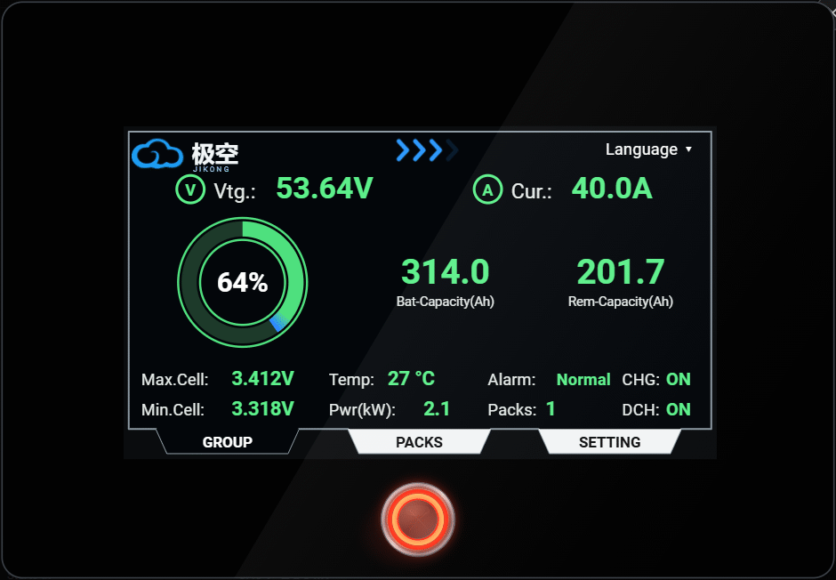
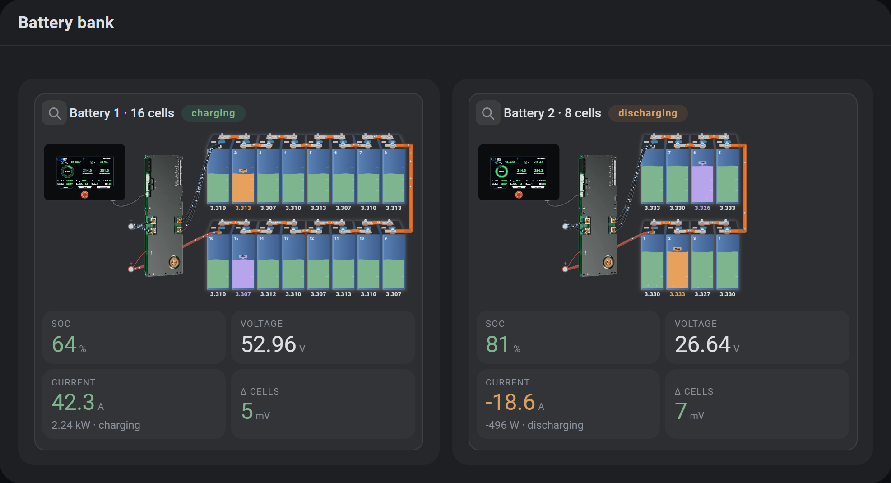
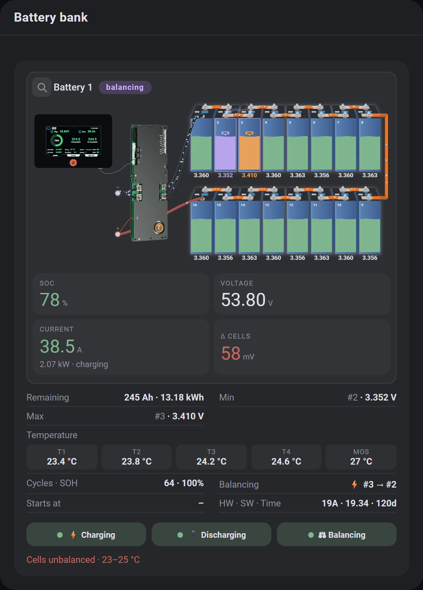
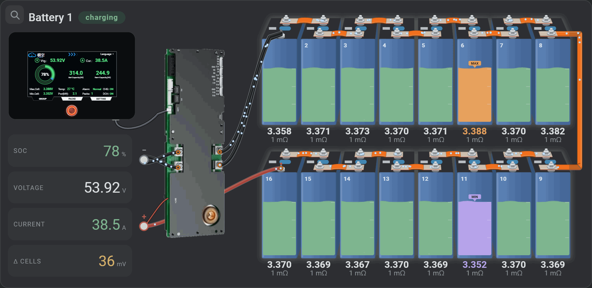
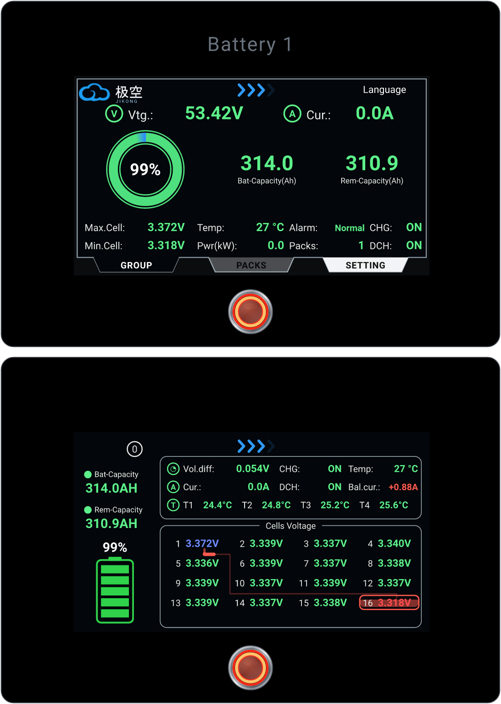
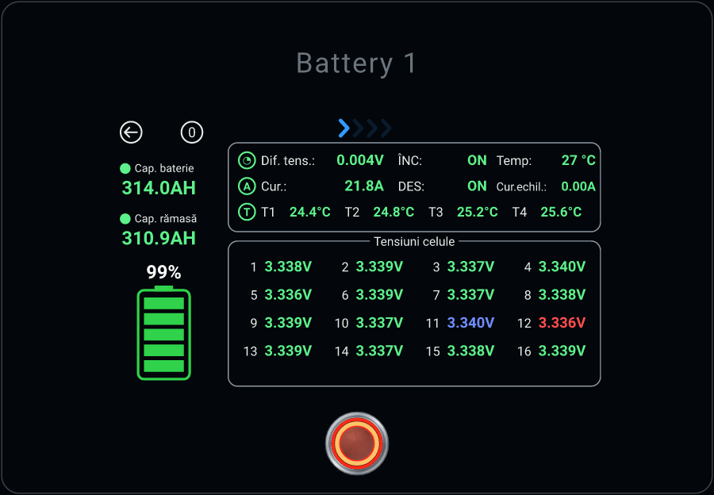
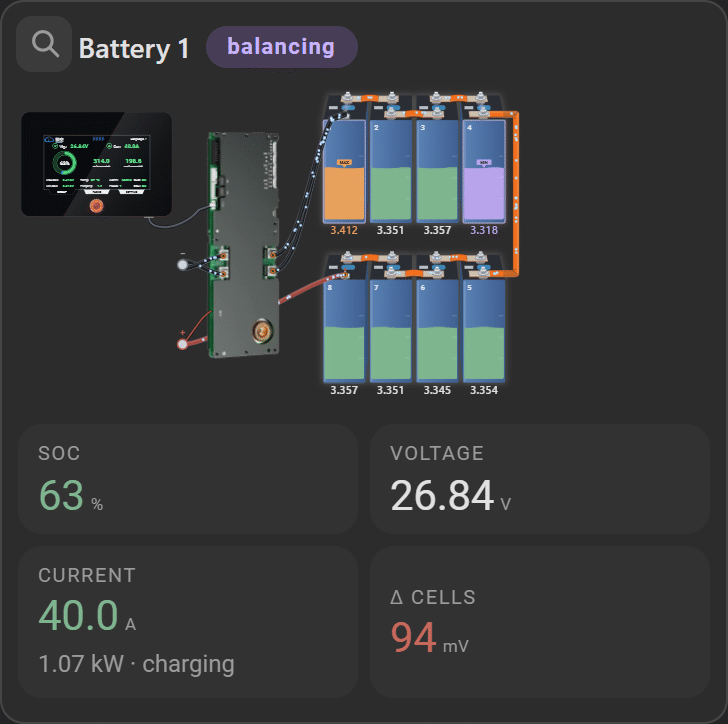
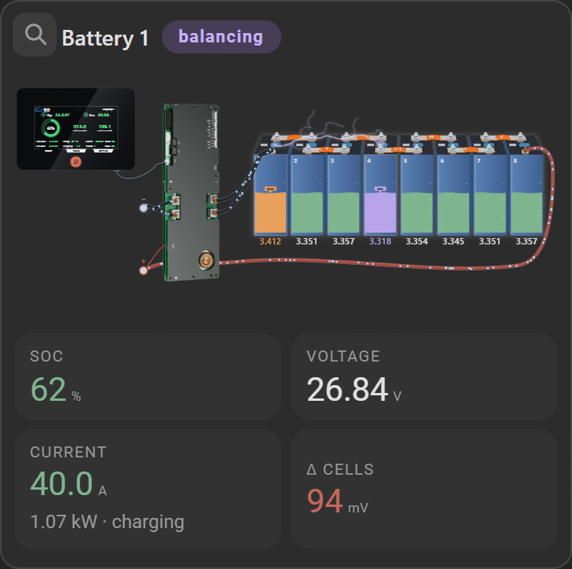
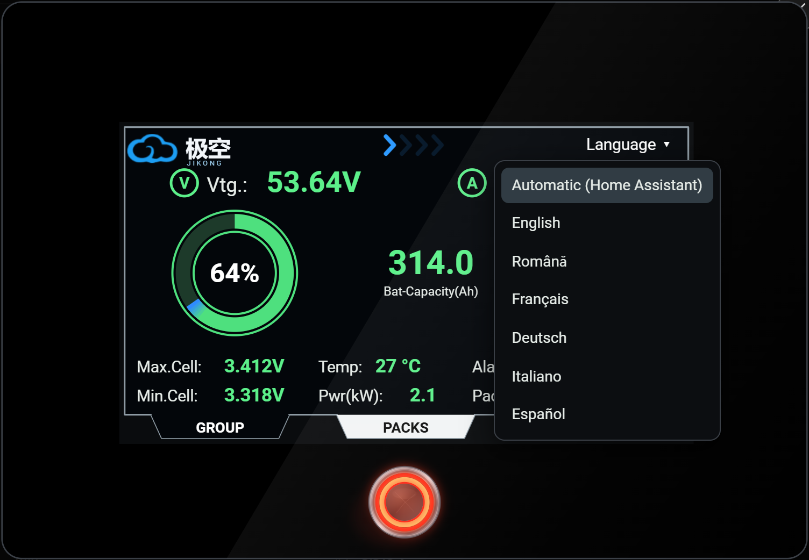

# JK-BMS Battery Card
<p align="center"></p>
<p align="center"><a href="https://buymeacoffee.com/valimaties"></a></p>

A Home Assistant dashboard card for **JK-BMS** battery packs (ESPHome, [syssi/esphome-jk-bms](https://github.com/syssi/esphome-jk-bms)): one calm card per battery with the real pack drawn cell by cell, live current flow, balancing, a replica of the JK touch screen and optional Victron SmartShunt / MultiPlus data. No dependencies.



One complete battery card, with the BMS screen replica, the numbers, the facts table and the switches:

<p align="center"></p>

Balancing: the highest cell gives to the lowest one and the two are joined by a lightning, wherever they are in the pack:

<p align="center"></p>

## What's new in 1.0.3

- **Screen-only mode**: the card can show nothing but the JK display, with the main screen, the cells screen, or both one under the other (see *Screen-only mode*).
- **SETTING page on the screen**: change the display mode, the battery name, the number of cells, the cell layout and the round button, and save it into the dashboard.
- **Balancing current on the cells screen**: red for a positive current (the lowest cell is charged), blue for a negative one (the highest cell is discharged); the two cells are joined by a moving line and the charged / discharged cell is outlined and filled by a moving band.
- **Row of temperature sensors (T1…T4) and the MOS temperature with its unit** on the cells screen.
- **Labels and values aligned in every language**: the labels of the screen shrink to fit their column.
- **Tooltip on the round button** of the display: *Turn the display off* / *Turn the display on*.

> **Tested only with the JK BMS PB2A16S20P v19.** Using the card with another BMS (other model or firmware, different entity names or values) is your own responsibility: expect that things may not work as shown.
>
> **This card is distributed "as is"**, without any warranty of any kind and without any promise of support or fixes. You use it at your own risk.

## Features

- **Pack drawing** (2 rows of cells, 8 or 16 cells per battery): cell voltage and internal resistance, liquid level = SoC, highest cell (MAX) and lowest cell (MIN) marked from the BMS sensors `max_voltage_cell` / `min_voltage_cell`, busbars and cables, electrons moving in the real direction of the current.
- **Balancing**: the lightning between the highest and the lowest cell, and the status chip *balancing* while the balancer works.
- **BMS screen replica**: click it to enlarge. GROUP / PACKS / cells pages like the real display, the round button switches the `display_always_on` switch, the *Language* label changes the language of the whole card (see *Translations*).
- **SETTING page on the screen**: display mode (full card / screen only), battery name, number of cells, cell layout (8 cells) and the round button on every page. *Save to dashboard* (asks for a second click) writes the change into the dashboard configuration, so it needs a dashboard in the UI editor (not YAML mode) and an administrator account; otherwise use the card editor.
- **Balancing current on the cells page of the screen**: positive (red): the lowest cell receives energy; negative (blue): the highest cell gives energy away. The two cells are joined by a moving line, from the highest to the lowest one, and the cell that is charged or discharged is outlined and filled by a band that rises (charging) or falls (discharging).
- **Screen-only mode**: only the JK display, the main screen, the cells screen or both, for dashboards that just want the screen (see *Screen-only mode*).
- **Master / slave groups** (declared in the card, the integration sees every BMS separately): one card, a selector chooses the pack, the screen shows the group totals.
- **Safe switches**: charging / discharging / balancing / heating ask for confirmation.
- **Every value opens its entity** (more-info).
- **Languages**: English, Français, Deutsch, Italiano, Español, Română (bundled in the card, easy to extend).
- **Light rendering** for phones and tablets (automatic, or forced from the editor).
- Visual editor (battery detection, group roles, language, performance, show or hide the Heating button) with a **manual sensor selection for each battery**, for BMS units whose entities do not have the standard names.
- **Victron SmartShunt / MultiPlus data is optional**: a line with the SmartShunt, MultiPlus and history values under the batteries; leave `victron` out and nothing Victron-related is shown (see *Victron*).

## Installation

### HACS (custom repository)

1. HACS → ⋮ → **Custom repositories** → add `https://github.com/valimaties/jk-bms-battery-card`, type **Dashboard**.
2. Install **JK-BMS Battery Card**, then reload the browser (Ctrl+F5).
3. If the resource was not added automatically: *Settings → Dashboards → ⋮ → Resources* → add `/local/community/jk-bms-battery-card/jk-bms-battery-card.js` as **JavaScript module**.

### Manual

The repository always contains the built card in the **`dist/`** folder (`main` and `dev`). Copy the single file `jk-bms-battery-card.js` from `dist/` (or from the latest release) to `/config/www/community/jk-bms-battery-card/`, add the resource `/local/community/jk-bms-battery-card/jk-bms-battery-card.js` (JavaScript module) and reload the browser.

> Everything is in that one file, translations included: there is nothing else to copy.

## Usage

Add the card from the picker (**JK-BMS Battery**); it detects the batteries (`sensor.*_cell_voltage_1`) and the Victron entities it finds. Or in YAML:

```yaml
type: custom:jk-bms-battery-card
batteries:
  - name: Battery 1
    entity_base: jk_bms_bms0     # sensor.jk_bms_bms0_cell_voltage_1 -> base = jk_bms_bms0
    role: master                 # optional: master | slave
    cells: 16                    # 8 or 16 cells in this battery
    temps: 4                     # temperature sensors of this battery (0-4)
  - name: Battery 2
    entity_base: jk_bms_bms1
    role: slave
    cells: 8
    temps: 2
```

### Options

| Option | Default | Description |
|---|---|---|
| `title` | translated "Battery bank" | Card title |
| `batteries[].name` | entity base | Name shown on the card |
| `batteries[].entity_base` | – | Entity id without `sensor.` and without the `_cell_voltage_1` suffix |
| `batteries[].entities` | – | Override single entities that do not have the standard names; the editor fills it in, see *Custom entity names* |
| `batteries[].layout` | `top-left` (1st), `bottom-left` (2nd) | Corner where cell 1 is drawn: `top-left`, `top-right`, `bottom-left`, `bottom-right` |
| `batteries[].cells` | `16` | Cells of this battery: 8 or 16 (the cells keep their size, the row just ends earlier) |
| `batteries[].temps` | `4` | Temperature sensors of this battery (0–4; the MOS temperature is read from its own sensor) |
| `batteries[].rows` | `2` | Only for 8 cells: `1` = one row of 8, `2` (default) = two rows of 4, see *8 cells* below |
| `batteries[].heating` | `true` | `false` hides the Heating button (for a BMS without heating plates). Without this option the button is shown when the BMS has the heating switch |
| `batteries[].role` | – | `master` for one battery, `slave` for the others: one card with a pack selector |
| `view` | `full` | `full` (the whole card) or `screen` (only the JK display: no BMS, cells, numbers or texts) |
| `view_page` | `group` | With `view: screen`: `group` (main screen) or `cells` (screen with the cell voltages). Add the card twice to show both |
| `screen_cells` | `false` | With `view: screen`: also draws the cells screen under the main screen (one card instead of two); the PACKS page is then switched off |
| `button_all_pages` | `true` | `false` draws the round display button only on the main page of the screen (not on the cells page) |
| `glare` | `true` | Light reflection on the BMS screen |
| `language` | `auto` | `auto` (Home Assistant language) or `en` `fr` `de` `it` `es` `ro` |
| `performance` | `auto` | `auto` (light on touch / weak devices), `full`, `lite` |
| `translations_path` | next to the card | Optional: URL of a folder with `translations/<code>.json` for a language that is not bundled |
| `victron` | – | Optional SmartShunt / MultiPlus entities, see below |

### Screen-only mode

For a dashboard that only needs the display, set `view: screen`: no BMS, no cells, no numbers or texts around it, just the JK screen with the name of the battery in grey above it. You choose the page of the screen:

```yaml
type: custom:jk-bms-battery-card
view: screen
view_page: group        # group = main screen (default), cells = screen with the cell voltages
batteries:
  - name: Battery 1
    entity_base: jk_bms_bms0
```

To show the main screen and the cells screen one under the other, in the same card, add `screen_cells: true`:

```yaml
type: custom:jk-bms-battery-card
view: screen
screen_cells: true
batteries:
  - name: Battery 1
    entity_base: jk_bms_bms0
```

<p align="center"></p>

- With `screen_cells` the **PACKS page is off** (the tab is greyed out and the back arrow of the cells page is hidden): every battery has its own two screens. With a master / slave group a selector above the screens chooses the pack.
- The round button still switches the display on and off; its tooltip says what a click will do. `button_all_pages: false` draws it only on the main screen.
- The **SETTING** tab opens a page with the display mode (full card / screen only), the name of the battery, the number of cells, the cell layout (8 cells, full card), the button option and the cells screen under the main one. **Save to dashboard** asks for a second click and then writes the change into the dashboard configuration: it needs a dashboard edited in the user interface (not YAML mode) and an administrator account; otherwise use the card editor. The name and the cells can only be saved for a battery that is written in the card (not an auto-detected one).

#### Balancing on the cells screen

The sensor `balancing_current` tells what the balancer does:

- **positive** (red): the cell with the **lowest** voltage receives energy; the cell is outlined in red and a band rises in it;
- **negative** (blue): the cell with the **highest** voltage gives energy away; the cell is outlined in blue and a band falls in it.

The line between the two cells follows the free space between the numbers and never crosses one. The recordings below show many routes (the current alternates + and − from one pair to the next, the cells with the highest and the lowest voltage change like on a real pack, the battery is at 99 %):

<details>
<summary>Balancing routes (4 recordings)</summary>

<p align="center"><b>Same row</b> (column 1→4, 4→1, 1→3, 4→2, …)<br></p>
<p align="center"><b>Same column</b> (top to bottom, bottom to top, …)<br></p>
<p align="center"><b>Next row, another column</b><br></p>
<p align="center"><b>Far diagonals</b><br></p>

</details>

### 8 cells: two rows of 4 or one row of 8

A battery with 8 cells can be drawn in two different ways, chosen per battery in the editor (**Cell layout**) or with `rows` in YAML:

- **2 rows of 4** (default): two rows joined at the right end by the reversed-C busbar, the cables run to the first cell of the top row and from the last cell of the bottom row.
- **1 row of 8** (`rows: 1`): all the cells in one row, centred on the BMS; there is no long busbar, the black cables go to the minus terminal of cell 1 (the one next to the BMS) and the red cable runs round the end of the row and under it, to the plus terminal of cell 8. In this layout cell 1 is always the one next to the BMS, so the *cell 1 position* option is not used.

```yaml
batteries:
  - name: Battery 1
    entity_base: jk_bms_bms0
    cells: 8
    rows: 1      # 1 = one row of 8, omit (or 2) = two rows of 4
```

The animations below show both layouts while the battery is charging and then discharging at 40 A, with the balancing going between the highest and the lowest cell:

<p align="center"><b>2 rows of 4</b><br></p>
<p align="center"><b>1 row of 8</b><br></p>

### Entities used

For each battery (`<base>` = `entity_base`): `sensor.<base>_cell_voltage_1..16`, `_cell_resistance_1..16`, `_total_voltage`, `_current`, `_power`, `_state_of_charge`, `_state_of_health`, `_capacity_remaining`, `_charging_cycles`, `_min_cell_voltage`, `_max_cell_voltage`, `_min_voltage_cell`, `_max_voltage_cell`, `_delta_cell_voltage`, `_balancing`, `_balancing_current`, `_temperature_sensor_1..4`, `_power_tube_temperature`, `_errors`, `_hardware_version`, `_software_version`, `_total_runtime_formatted`; `switch.<base>_charging|discharging|balancer|heating|display_always_on`; `number.<base>_balance_starting_voltage|balance_trigger_voltage|total_battery_capacity`; `binary_sensor.<base>_online_status`. Missing entities simply show `–`.

### Custom entity names

If your BMS entities do not follow the standard names above (a different `entity_base`, renamed sensors, a different integration), you can choose every sensor by hand:

1. Open the card editor and, under the battery, open **Sensors (manual, for custom entity names)**.
2. Every field already shows the entity found under the standard name. Change only the ones that are different in your installation. The fields are grouped: main values, cell statistics, temperatures, cell voltages, cell resistances, switches and other.
3. Only the entities that differ from the standard name are saved, in `batteries[].entities`:

```yaml
batteries:
  - name: Battery 1
    entity_base: jk_bms_bms0
    entities:
      total_voltage: sensor.my_pack_voltage
      cell_voltage_3: sensor.cell3_v
      charging: switch.my_charge_mosfet
```

The key is the end of the standard name (`total_voltage`, `cell_voltage_3`, `temperature_sensor_1`, `power_tube_temperature`, `charging`, ...).

### Victron (optional)

Victron is **optional and tested only with Venus OS** (Cerbo / GX / Raspberry Pi running Venus OS, entities like `sensor.victron_mqtt_...`). Without a `victron:` block the card shows only the batteries. Map the entities yourself if yours are named differently:

```yaml
victron:
  soc: sensor.victron_mqtt_battery_290_battery_soc
  voltage: sensor.victron_mqtt_battery_290_battery_voltage
  current: sensor.victron_mqtt_battery_290_battery_current
  power: sensor.victron_mqtt_battery_290_battery_power
  # also: time_to_go, battery_state, multiplus_voltage, inverter_state, system_state,
  #       dc_temp, consumed_ah, cycles, last_full_charge, alarm_low_battery
```

## Translations

The language can also be changed from the BMS screen: enlarge the screen, click **Language** and pick one (or *Automatic*, which follows Home Assistant). The whole card changes at once. The choice is remembered in that browser and wins over the `language` option.

<p align="center"></p>

`translations/<code>.json`, one file per language, all bundled into the card by the build; English is the fallback. To add a language copy `translations/en.json` to `translations/<code>.json`, translate the values (keep the keys and the `{name}`-style placeholders), set `"_name"` and add the language to the list at the top of `src/i18n.js`. Pull requests are welcome. The texts drawn on the BMS screen are translated too (`scr_*` keys).

## Performance

The drawing is SVG with CSS and a few light timers. On phones and tablets the card switches to *lite* automatically (no bubbles, waves or glows, fewer electrons, slower refresh); force it with `performance: lite`. While a card editor is open the cards stay still, and a card that is off screen does not animate or refresh.

## Development

The source is split into modules in `src/` (styles, translations, Victron discovery, pack drawing, card, editor); `esbuild` bundles them into one file, `dist/jk-bms-battery-card.js`, which is what Home Assistant loads.

```bash
npm install
npm run build        # dist/jk-bms-battery-card.js (dist/ is committed: always rebuild before committing)
npm run watch        # rebuild on every change
npm run deploy -- "\\homeassistant.local\config"   # build + copy to a Home Assistant /config (Samba share) for testing
```

Releases: publish a GitHub release (tag `v1.2.3`); the workflow builds with that version and attaches `jk-bms-battery-card.js`.

## Support

The card is free. If it is useful to you and you want to say thanks, you can [buy me a coffee](https://buymeacoffee.com/valimaties). It is entirely optional and does not change anything about support or the license.

## Credits

Licensed under the [MIT License](LICENSE). Built for the entities of [syssi/esphome-jk-bms](https://github.com/syssi/esphome-jk-bms). JK-BMS, EVE and Victron are trademarks of their owners; this project is not affiliated with them.
